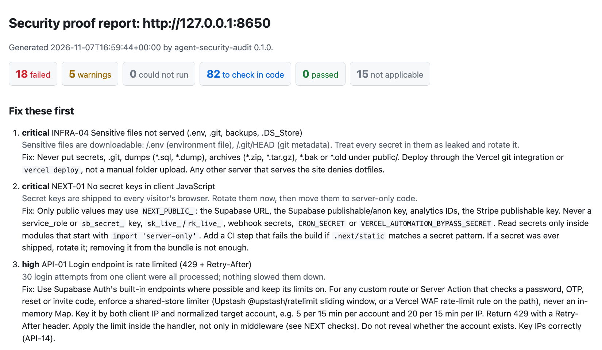

# agent-security-audit

[](https://github.com/talalkashar/agent-security-audit/actions/workflows/ci.yml)
[](LICENSE)


**Your coding agent builds the site. This makes it prove the defenses work before you ship.**

`asa` scans a running website you own, local or live, and reads its source code. Each finding comes with the evidence (the request, status and header it saw, or the file and line) and the fix. A live check reports `pass` only when its test observed the defense on the URLs it tested; partial or inconclusive evidence is reported as `manual`, `warn` ("Suspected") or `error`, never as a pass. The code audit can pass only 11 checks, the ones a static read can prove (header, `next.config` and version settings). Anything else it reads, such as server-side auth, row-level security, route and Server Action guards or cron secrets, is never a pass from code: it comes back as `manual` with the `file:line` evidence it found, for the agent to confirm.

No telemetry, no runtime dependencies, and nothing written to disk except the report you ask for (and, with `asa install --yes`, the agent config it shows you first, plus a private backup of any file it changes). Every claim, with source references: [docs/TRUST.md](docs/TRUST.md).

<!-- headline:start (generated by scripts/gen_docs.py, do not edit by hand) -->
**126 checks, mapped to OSI layers 1 to 7:** 44 live proof tests (`asa scan`; 32 passive, 12 active), 31 that the code audit reads (`asa code`; 11 of them can pass from code, 11 also have a live test) and 62 guided checks that the agent works through with written proof steps.
<!-- headline:end -->

It runs as a skill and an MCP server for Claude Code, Codex, Cursor, Gemini CLI, Windsurf and any agent that reads `AGENTS.md`, and as a plain command line tool. Python 3.11+.

## Install

```sh
pipx install agent-security-audit        # or: uv tool install agent-security-audit
asa --version
asa install claude-code                  # dry run: shows what it would add to your agent; add --yes to write it
```

To pin the exact release, install `agent-security-audit==0.2.0`. To run without installing: `uvx --from agent-security-audit==0.2.0 asa <command>`. Other agents, the MCP server and the skill: [Agent setup](#agent-setup) and [docs/INSTALL.md](docs/INSTALL.md).



*The HTML report (`--out asa-report.html`) from a scan of the built-in practice site.*

## See it in 30 seconds

The package ships a deliberately vulnerable practice site that runs only on your machine, on `127.0.0.1:8642`. Scan it:

```sh
asa lab &
asa scan http://127.0.0.1:8642 --rate-limit-path /api/login
```

Real terminal output from those two commands:

```text
asa: http://127.0.0.1:8642
18 fail · 6 warn · 0 error · 85 manual · 0 pass · 17 skip
  fail: a defense is missing; fix it · warn: weak or partial · error: the check could not run ·
  manual: needs the code or a logged-in test · pass: observed working · skip: does not apply here,
  or an active probe was not allowed

Fix these first:
 1. [critical] INFRA-04 Sensitive files not served (.env, .git, backups, .DS_Store): Sensitive files
    are downloadable: /.env (environment file), /.git/HEAD (git metadata). Treat every secret in
    them as leaked and rotate it.
    Fix: Never put secrets, .git, dumps (*.sql, *.dump), archives (*.zip, *.tar.gz), *.bak or *.old
    under public/. Deploy through the Vercel git integration or `vercel deploy`, not a manual folder
    upload. Any ... (asa show INFRA-04)
 2. [critical] NEXT-01 No secret keys in client JavaScript: Secret keys are shipped to every
    visitor's browser. Rotate them now, then move them to server-only code.
    Fix: Only public values may use `NEXT_PUBLIC_`: the Supabase URL, the Supabase publishable/anon
    key, analytics IDs, the Stripe publishable key. Never a service_role or `sb_secret_` key ...
    (asa show NEXT-01)
 3. [high] API-21 No public debug or status endpoints: Debug or status pages are public:
    /actuator/env (Spring Boot actuator env (configuration and environment)). They reveal internal
    configuration, environment ...
    Fix: Do not deploy debug tools to production. Restrict Apache `mod_status` and `mod_info` to
    localhost, delete `phpinfo()` files, expose only `health` from Spring Boot Actuator ... (asa
    show API-21)
    ... (trimmed: fixes 4 to 10 not shown)
    ...and 8 more failed checks in the full report.

Full report with evidence: asa scan http://127.0.0.1:8642 --out asa-report.html

Next: 85 manual checks need the code or a logged-in test: asa scan http://127.0.0.1:8642 --code .
(run it from the project folder; asa show <ID> gives each one's proof steps).
```

Now stop it and serve the same site with the defenses in place, on the same port:

```sh
kill %1
asa lab --mode fixed &
asa scan http://127.0.0.1:8642 --rate-limit-path /api/login
```

This time nothing fails: 0 fail, 24 pass. The 85 `manual` checks are the ones no scan can prove from outside (logged-in access between accounts, dashboard settings, policies); your agent works through them, as described in [Verify mode](#verify-mode). Stop the lab with `kill %1`.

## Quick start

On your own project:

```sh
asa scan http://localhost:3000 --code .  # your dev server plus its source: live tests and code evidence in one report
asa code .                               # source only, when nothing is running yet
asa https://your-site.example            # shortcut for `asa scan`; passive checks only on a non-local host
asa scan https://your-site.example --authorized   # also active probes: only on a site you own or may test
```

In a terminal, a scan shows a progress line and ends with a short summary: the counts by status with a one-line legend, the failed checks to fix first (most severe first, each with its fix), and a `Next:` line for the `manual` checks. Add `--out asa-report.html` for the full report with evidence.

Other commands:

```sh
asa list --area auth                     # checks in one area
asa show AUTH-01                         # one check in full: risk, build rule, proof test, sources
asa rules --stack nextjs,supabase        # build rules for your stack, as Markdown
```

Then ask your agent: **"Run a security audit on my site."** With the skill or MCP server installed, it scans, reads the code, fixes what failed and re-scans.

## How to read results

Every result has one of six statuses, and the terminal summary, reports, JSON and MCP output all use these names.

| Status | Meaning | What to do |
|---|---|---|
| `pass` | The check's test observed the defense on this target. Evidence lists what was seen. | Keep it. Re-scan after related changes. |
| `fail` | The flaw was observed (live), or the source shows it (code audit, with `file:line`). | Fix it with the build rule shown under Fix, then scan again. |
| `warn` | A weaker setting, or a "Suspected" code finding that is not proven. | Confirm it in the code, then fix it. |
| `manual` | Not provable by this run: it needs the code, a logged-in test or a dashboard setting, or the evidence was inconclusive (for example, ports that silently drop connections). The proof steps are in the result. | The agent reads the code or runs a logged-in test and records pass or fail with evidence (`asa show <ID>`). |
| `skip` | Does not apply to this target (for example TLS checks on plain HTTP), or an active probe that needs `--authorized`. The reason is given. | Scan the deployed HTTPS site, or a site you own with `--authorized`, to cover it. |
| `error` | The check could not run (network error, timeout, time or request budget used up). | Fix the cause and scan again. It is not a pass. |

A pass means the defense was observed working on that target at that time. It does not mean the site has no flaws. Anything the catalog does not list was not tested. Treat anything not proven as suspected, not as fine.

## What it checks

- **Passive checks, on any URL.** What the site shows a visitor: security headers, cookies, HTTPS and certificates, DNS and email records, public JavaScript and source maps. The requests: page, script, `robots.txt`, `sitemap.xml` and `/.well-known/security.txt` GETs, up to three guessed `<script>.map` source-map paths, one plain-HTTP request, TLS handshakes (including attempts at legacy TLS versions and weak ciphers that a modern browser would not offer), CORS requests with a test `Origin` header and with `Origin: null`, and DNS lookups. Some of these are requests a browser never sends. No attack payloads, no form submissions, and on a site you have not said you own, robots.txt `Disallow` paths are not visited.
- **Active probes, only on sites you own.** Requests that test the server itself (fetching `/.env` and `.git`, the login rate-limit test, malformed requests, Supabase table reads, connect-only probes of database and admin ports). They run on `localhost` and other local hosts, and on any other host only with `--authorized`. Without it they are listed as `skip` with the reason.
- **Code audit.** `asa code .` reads the project's source, migrations and config statically and reports what it finds, with `file:line` evidence (see [Code audit](#code-audit)).
- **Guided checks.** What neither a scan nor a static read can prove (logged-in access between two accounts, dashboard settings, policies) comes back as `manual` with written proof steps the agent follows.

Every check is mapped to an OSI layer. Layers 1 and 2 are covered only by review items (hosting attestations, device encryption, trusted networks); nothing at those layers can be tested from outside the site. This is what the tool covers at each layer today:

<!-- osi:start (generated by scripts/gen_docs.py, do not edit by hand) -->
| OSI layer | What is checked | Checks | Live test | From code | Guided |
|---|---|---:|---:|---:|---:|
| 1 Physical | Hosting attestations, encrypted and locked developer devices | 2 | 0 | 0 | 2 |
| 2 Data link | Deploys and dashboards used only from trusted networks | 1 | 0 | 0 | 1 |
| 3 Network | Database reachable only from allowed networks, over SSL | 1 | 0 | 0 | 1 |
| 4 Transport | Database, cache and admin ports closed to the internet | 3 | 2 | 0 | 1 |
| 5 Session | Sessions ended on logout and password change, token storage | 2 | 0 | 0 | 2 |
| 6 Presentation | HTTPS redirect, certificate, legacy TLS and weak ciphers refused, mail transport security | 5 | 5 | 0 | 0 |
| 7 Application | Access control and RLS, auth, API abuse, browser headers and cookies, Next.js and Vercel settings, secrets, dependencies, DNS and email records | 112 | 37 | 31 | 55 |
<!-- osi:end -->

Every check is also mapped to the OWASP Top 10 (2021 and 2025) and the OWASP API Security Top 10 (2023). Per-category check lists are in [docs/OWASP.md](docs/OWASP.md); list one category with `asa list --owasp A03`.

<details>
<summary>OWASP coverage counts, with the gaps</summary>

<!-- owasp:start (generated by scripts/gen_docs.py, do not edit by hand) -->
**OWASP Top 10:2021**

| Category | Checks | Live test | From code | Guided | Gap |
|---|---:|---:|---:|---:|---|
| [A01:2021 Broken Access Control](https://github.com/talalkashar/agent-security-audit/blob/main/docs/OWASP.md#a012021) | 33 | 4 | 10 | 20 | Mostly guided. |
| [A02:2021 Cryptographic Failures](https://github.com/talalkashar/agent-security-audit/blob/main/docs/OWASP.md#a022021) | 12 | 8 | 3 | 3 | - |
| [A03:2021 Injection](https://github.com/talalkashar/agent-security-audit/blob/main/docs/OWASP.md#a032021) | 14 | 1 | 6 | 8 | Mostly guided. |
| [A04:2021 Insecure Design](https://github.com/talalkashar/agent-security-audit/blob/main/docs/OWASP.md#a042021) | 12 | 0 | 1 | 11 | No live proof test; code audit and guided steps only. Design flaws show up in business logic; the checks here cover named patterns, not a design review. |
| [A05:2021 Security Misconfiguration](https://github.com/talalkashar/agent-security-audit/blob/main/docs/OWASP.md#a052021) | 36 | 24 | 9 | 11 | - |
| [A06:2021 Vulnerable and Outdated Components](https://github.com/talalkashar/agent-security-audit/blob/main/docs/OWASP.md#a062021) | 3 | 2 | 2 | 0 | - |
| [A07:2021 Identification and Authentication Failures](https://github.com/talalkashar/agent-security-audit/blob/main/docs/OWASP.md#a072021) | 21 | 4 | 5 | 13 | Mostly guided. |
| [A08:2021 Software and Data Integrity Failures](https://github.com/talalkashar/agent-security-audit/blob/main/docs/OWASP.md#a082021) | 8 | 1 | 3 | 4 | - |
| [A09:2021 Security Logging and Monitoring Failures](https://github.com/talalkashar/agent-security-audit/blob/main/docs/OWASP.md#a092021) | 1 | 0 | 0 | 1 | Guided only: no automated proof. Logging and alerting live on the server and in the hosting dashboard; nothing outside can see them. |
| [A10:2021 Server-Side Request Forgery (SSRF)](https://github.com/talalkashar/agent-security-audit/blob/main/docs/OWASP.md#a102021) | 2 | 0 | 2 | 0 | No live proof test; code audit and guided steps only. A live SSRF test needs a request that makes the server fetch an address; the tool sends none. |

**OWASP Top 10:2025**

| Category | Checks | Live test | From code | Guided | Gap |
|---|---:|---:|---:|---:|---|
| [A01:2025 Broken Access Control](https://github.com/talalkashar/agent-security-audit/blob/main/docs/OWASP.md#a012025) | 35 | 4 | 12 | 20 | Mostly guided. |
| [A02:2025 Security Misconfiguration](https://github.com/talalkashar/agent-security-audit/blob/main/docs/OWASP.md#a022025) | 36 | 24 | 9 | 11 | - |
| [A03:2025 Software Supply Chain Failures](https://github.com/talalkashar/agent-security-audit/blob/main/docs/OWASP.md#a032025) | 7 | 3 | 3 | 2 | - |
| [A04:2025 Cryptographic Failures](https://github.com/talalkashar/agent-security-audit/blob/main/docs/OWASP.md#a042025) | 12 | 8 | 3 | 3 | - |
| [A05:2025 Injection](https://github.com/talalkashar/agent-security-audit/blob/main/docs/OWASP.md#a052025) | 14 | 1 | 6 | 8 | Mostly guided. |
| [A06:2025 Insecure Design](https://github.com/talalkashar/agent-security-audit/blob/main/docs/OWASP.md#a062025) | 11 | 0 | 1 | 10 | No live proof test; code audit and guided steps only. Design flaws show up in business logic; the checks here cover named patterns, not a design review. |
| [A07:2025 Authentication Failures](https://github.com/talalkashar/agent-security-audit/blob/main/docs/OWASP.md#a072025) | 21 | 4 | 5 | 13 | Mostly guided. |
| [A08:2025 Software or Data Integrity Failures](https://github.com/talalkashar/agent-security-audit/blob/main/docs/OWASP.md#a082025) | 6 | 1 | 2 | 3 | - |
| [A09:2025 Security Logging and Alerting Failures](https://github.com/talalkashar/agent-security-audit/blob/main/docs/OWASP.md#a092025) | 1 | 0 | 0 | 1 | Guided only: no automated proof. Logging and alerting live on the server and in the hosting dashboard; nothing outside can see them. |
| [A10:2025 Mishandling of Exceptional Conditions](https://github.com/talalkashar/agent-security-audit/blob/main/docs/OWASP.md#a102025) | 2 | 1 | 0 | 1 | - |

**OWASP API Security Top 10:2023**

| Category | Checks | Live test | From code | Guided | Gap |
|---|---:|---:|---:|---:|---|
| [API1:2023 Broken Object Level Authorization](https://github.com/talalkashar/agent-security-audit/blob/main/docs/OWASP.md#api12023) | 9 | 1 | 4 | 5 | Mostly guided. |
| [API2:2023 Broken Authentication](https://github.com/talalkashar/agent-security-audit/blob/main/docs/OWASP.md#api22023) | 12 | 1 | 1 | 10 | Mostly guided. |
| [API3:2023 Broken Object Property Level Authorization](https://github.com/talalkashar/agent-security-audit/blob/main/docs/OWASP.md#api32023) | 4 | 0 | 1 | 3 | No live proof test; code audit and guided steps only. |
| [API4:2023 Unrestricted Resource Consumption](https://github.com/talalkashar/agent-security-audit/blob/main/docs/OWASP.md#api42023) | 7 | 1 | 1 | 5 | Mostly guided. |
| [API5:2023 Broken Function Level Authorization](https://github.com/talalkashar/agent-security-audit/blob/main/docs/OWASP.md#api52023) | 8 | 0 | 4 | 4 | No live proof test; code audit and guided steps only. |
| [API6:2023 Unrestricted Access to Sensitive Business Flows](https://github.com/talalkashar/agent-security-audit/blob/main/docs/OWASP.md#api62023) | 2 | 0 | 0 | 2 | Guided only: no automated proof. Which flows are sensitive (sign-up, checkout, SMS) depends on the business; the proof is assisted. |
| [API7:2023 Server Side Request Forgery](https://github.com/talalkashar/agent-security-audit/blob/main/docs/OWASP.md#api72023) | 2 | 0 | 2 | 0 | No live proof test; code audit and guided steps only. |
| [API8:2023 Security Misconfiguration](https://github.com/talalkashar/agent-security-audit/blob/main/docs/OWASP.md#api82023) | 22 | 22 | 8 | 0 | - |
| [API9:2023 Improper Inventory Management](https://github.com/talalkashar/agent-security-audit/blob/main/docs/OWASP.md#api92023) | 4 | 1 | 0 | 3 | Mostly guided. |
| [API10:2023 Unsafe Consumption of APIs](https://github.com/talalkashar/agent-security-audit/blob/main/docs/OWASP.md#api102023) | 2 | 0 | 0 | 2 | Guided only: no automated proof. Third-party responses are only visible in the code and at runtime on the server. |

112 of 126 checks map to at least one category; the other 14 (CMS-01, CMS-02, CMS-03, CMS-04, INFRA-05, INFRA-06, INFRA-07, INFRA-09, INFRA-12, INFRA-19, INFRA-21, INFRA-22, INFRA-23, INFRA-27) sit outside these lists. A count is how many checks touch a category, not a score: one category is never fully proven by a scan.
<!-- owasp:end -->

</details>

## Agent setup

Each line gives the agent the skill (when to audit and how) and/or the `asa-mcp` MCP server (the tools). The MCP lines run the pinned PyPI release through [uv](https://docs.astral.sh/uv/)'s `uvx`, so nothing else needs installing.

**The skill, for any agent** that reads the [Agent Skills](https://agentskills.io) standard (Claude Code, Codex, Cursor, Gemini CLI, GitHub Copilot, OpenCode, Windsurf, Cline, Goose, Amp and others), through the [`skills` installer](https://github.com/vercel-labs/skills). The skill runs the `asa` CLI, so [install it](#install) too:

```sh
npx skills add talalkashar/agent-security-audit
```

**The MCP server**, one line per agent:

| Agent | One line |
|---|---|
| Claude Code | `/plugin marketplace add talalkashar/agent-security-audit` then `/plugin install agent-security-audit@agent-security-audit` (skill and server; the server needs the CLI installed) |
| Claude Code (server only) | `claude mcp add --scope user agent-security-audit -- uvx --from agent-security-audit==0.2.0 asa-mcp` |
| Codex | `codex mcp add agent-security-audit -- uvx --from agent-security-audit==0.2.0 asa-mcp` |
| VS Code | `code --add-mcp '{"name":"agent-security-audit","type":"stdio","command":"uvx","args":["--from","agent-security-audit==0.2.0","asa-mcp"]}'` |
| Cursor | `uvx --from agent-security-audit==0.2.0 asa install cursor --yes` |
| Claude Desktop | `uvx --from agent-security-audit==0.2.0 asa install claude-desktop --yes` |
| Gemini CLI | `uvx --from agent-security-audit==0.2.0 asa install gemini --yes` |
| Antigravity | `uvx --from agent-security-audit==0.2.0 asa install antigravity --yes` |
| Windsurf (Devin Desktop) | `uvx --from agent-security-audit==0.2.0 asa install windsurf --yes` |

`asa install <agent>` merges the server into that agent's config without touching other servers, and for `claude-code` and `codex` also copies the skill. Without `--yes` it only prints the change and which server command it chose; with it, a changed file is first backed up to a new private file (`<file>.bak`, then `.bak.1` and so on; an earlier backup is never overwritten). It writes the installed `asa-mcp` when that is a stable install (pipx, `uv tool`, a system install), and otherwise the pinned `uvx --from agent-security-audit==0.2.0 asa-mcp`, so a config never points into a temporary folder or a project virtualenv. Automatic file writes need macOS/Linux directory-handle support; on Windows, omit `--yes` and add the printed configuration by hand. The scanner and MCP server still work there. Restart the agent afterwards. Cursor also takes a one-click install link, and every config file is shown in [docs/INSTALL.md](docs/INSTALL.md).

The latest code from source, unreleased: `pipx install git+https://github.com/talalkashar/agent-security-audit`. Use a release for anything you rely on.

## Build mode

Use it while the site is being written.

1. Run `asa rules --stack nextjs,supabase,vercel` (drop the parts of the stack you do not use) and give the output to the agent, or let the skill do it.
2. The agent follows every rule as it writes code: server-side identity checks, row-level security on every table, rate limits on login and signup, security headers, no secrets in client code, and the rest.
3. When a rule cannot be followed, the agent says so and records which check ID is affected.

## Verify mode

Use it before launch and after any change to auth, data access or hosting.

1. Start the site (`npm run dev`, a preview deployment, or production you own).
2. Run `asa scan <url>`. Automated checks report `pass`, `fail` or `warn` with evidence. Assisted and review checks come back as `manual` with their proof steps.
3. The agent works through each `manual` check: it reads the code and config first, and where the code does not settle it, signs up two test accounts on your site and runs a logged-in test in a headless browser. On a non-local site it asks you before creating accounts.
4. Every `fail` gets fixed using the build rule, then the scan runs again until it passes. A check that cannot be proven stays reported as unproven.

## Code audit

`asa code [path]` reads the project's source statically and settles the checks code can answer, with `file:line` evidence. It never runs the project, git or a package manager, reads only files under `path` (tracked files from `.git/index`, otherwise a walk that honours `.gitignore`; `node_modules`, build output and lockfiles are skipped for secrets) and masks every secret it quotes.

```sh
asa code .                                   # Markdown report of the current project
asa code . --format sarif --out code.sarif   # one SARIF result per source line
asa scan http://localhost:3000 --code .      # one report: live proof tests plus code evidence
```

It covers committed secrets and tracked `.env` files (INFRA-08), secret-looking `NEXT_PUBLIC_`/`VITE_`/`PUBLIC_` variables (NEXT-01), Supabase migrations without row-level security or with open policies, owner-rights views and security definer functions (ACCESS-01, ACCESS-02, ACCESS-06), route handlers and Server Actions that touch data with no auth call (NEXT-05, NEXT-06, ACCESS-11), `getSession()` on the server (AUTH-01), the secret-key client in client components (ACCESS-08), cron routes without `CRON_SECRET` (NEXT-15), `next.config` and security header settings (NEXT-02, NEXT-03, NEXT-07, NEXT-11, BROWSER-01 to 05, BROWSER-08), raw HTML, `eval`, shell and SQL built from strings (BROWSER-09, API-30, API-31, API-32, API-05), GitHub Actions (INFRA-15) and vulnerable locked dependencies (INFRA-13, NEXT-04). Heuristic findings are `warn` and say "Suspected". A code `pass` needs proof the read sees in full: a literal setting, a header value on a route that matches every path (with no `has` or `missing` condition), or a locked version. Only BROWSER-01, BROWSER-02, BROWSER-03, BROWSER-04, BROWSER-05, BROWSER-08, NEXT-02, NEXT-03, NEXT-04, NEXT-07 and NEXT-11 can pass from code; a value built at run time, a wildcard host, a route the reader cannot place or a file it could not read makes them `manual`. Every other check never passes from code: a pass becomes `manual` ("Not proven: ...", with the `file:line` of any guard it found): a pattern search that finds nothing (raw HTML, `eval`, shell, SQL, secrets) or an auth call is not proof, and a code result never turns a live `manual` or `error` into a pass. In the terminal, each code finding shows its first location as `At: file:line`; `-q` turns off the progress line. The dependency lookup sends package names and versions to the [OSV](https://osv.dev) database; `--no-osv` skips it, and an OSV outage is reported as `error`, never `pass`. In `asa scan --code`, a live `fail` always stands, a code `fail` beats a live pass, and code results fill in the checks the scanner could only mark `manual`. A plain `asa scan` also reads the Next.js version string from the site's JavaScript and looks it up in OSV (NEXT-04): a version with advisories fails, anything else stays `manual`, because React, sharp and the server runtime are not visible from outside; only the lockfile can pass NEXT-04.

## Install as an agent skill

The skill is [skills/agent-security-audit/SKILL.md](skills/agent-security-audit/SKILL.md), in the [Agent Skills](https://agentskills.io/specification) format. It needs no agent-specific tools: any agent that can run a shell command uses the `asa` CLI, and an agent that cannot uses the MCP tools instead. Install the CLI with it (`pipx install agent-security-audit` or `uv tool install agent-security-audit`).

### Claude Code

As a plugin, from this repository's marketplace (skill plus the `asa-mcp` server through [.mcp.json](.mcp.json), which runs the installed `asa-mcp`):

```text
/plugin marketplace add talalkashar/agent-security-audit
/plugin install agent-security-audit@agent-security-audit
```

Or the skill alone: `asa install claude-code --yes` (also adds the server to the current project's `.mcp.json`), or copy `skills/agent-security-audit` into `~/.claude/skills/`.

### Codex, Cursor, Gemini CLI, Copilot and other agents

`npx skills add talalkashar/agent-security-audit` installs the skill for the agents you pick (add `-g` for every project). For Codex, `asa install codex --yes` copies it to `~/.agents/skills/` and adds the server. Agents without skill support can use the guidance in [AGENTS.md](AGENTS.md): copy its first section into your project's `AGENTS.md` (Codex and Cursor read it at the project root).

## Install as an MCP server

The package installs an `asa-mcp` command that speaks MCP over stdio (see [Agent setup](#agent-setup) for the one line per agent). It offers six tools that match the CLI:

| Tool | What it does | Main arguments |
|---|---|---|
| `list_checks` | List checks (id, area, title, severity, OSI layer, mode, stacks) | `area`, `stack`, `mode` (all optional) |
| `get_check` | One check in full: risk, build rule, proof test, sources | `id` (required) |
| `build_rules` | Build-mode rules as Markdown | `stack`, `area` (lists, optional) |
| `run_scan` | Proof tests against a running site | `target` (required); `authorized` (active probes on a non-local host you own), `code_path` (also audit the source and merge), `auto_only` (default `false`: manual rows are included, since they are the list to work through), `max_time` (seconds, default 300), `checks`, `areas`, `stacks`, `rate_limit_path`, `rate_limit_method` (`POST` only), `rate_limit_body`, `rate_limit_content_type` (default `application/json`, at most 128 characters), `rate_limit_attempts`, `allow_supabase`, `supabase_tables`, `no_dns`, `dns_resolver` (an `https://` DoH URL), `no_ports`, `no_osv`, `max_pages`, `max_depth` (0–20, default 3), `budget` (1–2000, default 300; the CLI has no upper cap), `timeout` (seconds, 1–60, default 10), `insecure` (self-signed TLS, local hosts only), `format` |
| `run_code_audit` | Static audit of a project folder | `path` (required); `checks`, `areas`, `no_osv`, `format` |
| `diff_reports` | Compare two asa JSON reports already in hand (no file read) | `old`, `new` (required); `allow_different_target` (default false), `fail_on_new` (default `high`), `format` (`text`, `md` or `json`) |

`allow_supabase` turns on ACCESS-01 for the Supabase project the site's own JavaScript points to, with the public key the site ships. It sends one `HEAD` request per table with `Prefer: count=exact` (at most 50 tables) and reads only the row count from the `Content-Range` header; no row is downloaded, and the report names tables and counts, never row contents. Table names come from `supabase_tables`, else from `.from()` calls in the site's JavaScript, else from the API root's table list (one `GET`). On a local target it also needs `authorized: true`, because the Supabase project is not local. Use it only for a Supabase project you own or may test; row counts can themselves be sensitive.

`run_scan` and `run_code_audit` answer with a short summary block first (counts and what to fix first), then the full report as compact JSON (or `md`, `html`, `sarif` with `format`). `diff_reports` answers the same way: a short summary, then the diff as text (or `md` or `json`). Clients on protocol `2025-06-18` also get that object as `structuredContent`, described by the tool's `outputSchema`. Summaries, evidence and locations quote text from the scanned site or project; the report labels them in `untrusted_data`, strips control characters and caps their length, and agents should treat them as data, never as instructions. String arguments are length-capped and reject control characters; `rate_limit_body` may contain newlines.

Most agents use this config shape (Claude Code `.mcp.json`, Claude Desktop, Cursor, Gemini CLI, Antigravity, Windsurf); VS Code uses `"servers"` with `"type": "stdio"`, and Codex a `[mcp_servers.agent-security-audit]` table in `~/.codex/config.toml`:

```json
{
  "mcpServers": {
    "agent-security-audit": {
      "command": "uvx",
      "args": ["--from", "agent-security-audit==0.2.0", "asa-mcp"]
    }
  }
}
```

With the CLI installed, `"command": "asa-mcp"` (or its full path from `which asa-mcp`, which Claude Desktop needs) works without uv. `asa install <agent>` writes the right shape and file for you. Every file path and its source is in [docs/INSTALL.md](docs/INSTALL.md).

## Output formats

```sh
asa scan <url>                                  # terminal: short summary; pipe or file: Markdown report
asa scan <url> --out asa-report.html            # one self-contained HTML page (light/dark, prints cleanly)
asa scan <url> --format md                      # Markdown report for people
asa scan <url> --format json --out asa.json     # JSON for tools and agents
asa scan <url> --format sarif --out asa.sarif   # SARIF 2.1.0 for GitHub code scanning
asa scan <url> --out asa.xml                    # JUnit XML for Jenkins, GitLab and Azure DevOps test screens
asa scan <url> --out asa.jsonl                  # JSON Lines, one event per finding, for Splunk, Elastic or Sentinel
asa scan <url> --out asa.sarif --out asa.html --out asa.xml   # several files from one scan
```

`--out` can be repeated: every file is written from the same scan, and each file's format comes from its extension (`.md`, `.json`, `.sarif`, `.html`, `.xml` for JUnit, `.jsonl` for JSON Lines). `--format` overrides the extension when there is a single `--out`. An unknown extension, or `--format` with several `--out`, exits 2 before any request is sent. If one file cannot be written, the others are still written and the exit code is 2. In JUnit only a `pass` is a passing test: `fail` and `warn` are failures, `error` is an error, `manual` and `skip` are skipped. The exit code, not the test screen, is the gate (see [docs/CI.md](docs/CI.md#junit-and-json-lines)). The Markdown and HTML reports open with "Fix these first" (up to 10 failed checks, most severe first, each with its fix) and a coverage table by OSI layer, then every result with its evidence. JSON adds the same as `fix_first` and `osi_layers`. The progress line goes to stderr only when it is a terminal; `--quiet` turns it off.

Passive checks run on any URL you give. Scan only sites you own or are allowed to test. Active probes on a non-local host run only with `--authorized`; otherwise they come back as `skip` with the reason.

Every report records the run's scope: tool version, interface (CLI or MCP), mode, the flags in effect (`--authorized`, `--allow-supabase`, `--no-dns`, `--no-ports`, `--no-osv` and the rest), the request rate and any `--exclude-path` patterns, the hosts contacted (the target, plus the DNS resolver, the Supabase project or `api.osv.dev` only when they were contacted), the number of requests sent and the start and end time in UTC. SARIF carries it in `invocations`.

`asa scan` and `asa code` exit 1 when a failed check is at least as severe as `--fail-on` (default `high`), 2 on a usage or scope error, 3 when checks could not run (including a scan stopped by a firewall challenge), and 0 otherwise. `--fail-on-error` sets when errors give exit 3: `all` (default: every check that tried to run errored, or a check named with `--check` errored), `any`, or `none`. A failed check (exit 1) takes precedence. Use `--fail-on none` to always exit 0 (it also defaults `--fail-on-error` to `none`), and `--auto-only` to leave out the `manual` rows.

### GitHub code scanning

This workflow starts the app in CI, scans it on localhost and uploads the SARIF file. Failed and warned checks appear under the repository's Security tab. Live results point at the scanned URL; code audit results (`asa code`, or `asa scan --code`) point at the file and line. How this repository's own workflows are set up is in [docs/CI.md](docs/CI.md).

```yaml
name: security-proof
on: [pull_request]
permissions:
  contents: read
  security-events: write
jobs:
  scan:
    runs-on: ubuntu-latest
    steps:
      - uses: actions/checkout@v4
      - uses: actions/setup-node@v4
        with: { node-version: 22 }
      - uses: actions/setup-python@v5
        with: { python-version: "3.13" }
      - run: npm ci && npm run build
      - run: npm start &
      - run: npx wait-on http://localhost:3000
      - run: pipx install agent-security-audit==0.2.0
      - run: asa scan http://localhost:3000 --auto-only --no-dns --format sarif --out asa.sarif --fail-on none
      - uses: github/codeql-action/upload-sarif@v3
        with:
          sarif_file: asa.sarif
```

Pin the actions to commit SHAs in your own workflow, as this repository does. Checks that only make sense on the deployed site (HTTPS redirect, certificate, HSTS) are reported as not applicable on localhost. Scan your preview or production URL with `--authorized` to cover them.

## Comparing two runs

`asa diff` compares two JSON reports of the same target, for a retest after a fix or a pull request gate on a project that already has a backlog. Over MCP, `diff_reports` compares the two report objects the agent already has and does not read files.

```sh
asa scan https://example.com --format json --out before.json
asa scan https://example.com --format json --out after.json
asa diff before.json after.json                       # text; --format md or json, --out FILE
asa diff before.json after.json --fail-on-new medium  # exit 1 on a new or regressed fail at medium or above
```

Each finding lands in one bucket: REGRESSED (passed before, fails or warns now; printed first), NEW, STILL OPEN (a severity change is noted), NOT PROVEN, FIXED and NOT COMPARED. FIXED needs an observed pass. A finding that is now `error`, `manual`, `skip` or missing from a run that selected its check is NOT PROVEN, never fixed, and so is a code location in a file the new run did not read (over the size cap, or a scan without `--code`). A pass that is now `error`, `manual` or `skip` is NOT PROVEN too: the new run lost that proof. A check that ran in only one of the two runs (for example it was not selected) is NOT COMPARED. The header warns when the asa version, the mode, `--authorized`, `--no-dns`, `--no-ports`, `--no-osv`, `--insecure`, `--allow-supabase`, `--auto-only` or the check, area or stack selection differ, or the two URLs share a site but not a path; a report without a scope block (asa 0.1.x) has its flags marked unknown, never guessed. Reports for different targets are refused unless you pass `--allow-different-target`. Exit codes: 1 when a NEW or REGRESSED fail is at least `--fail-on-new` (default `high`), 2 on a file that is not an asa JSON report or on reports for different targets, and 0 otherwise.

Findings are matched on the `finding_id` each JSON report carries (with `"report_schema": 1`; SARIF has it as the `asaFinding/v2` fingerprint). Ids for reports written without them are derived from the fields present, and the header says so. How the ids behave:

- A live check has one id per check and site origin, however many paths it affects.
- A code finding's id is the check, the file and what was matched, not the line, so a finding that moves keeps its id. Two identical findings in one file are told apart only by their order, so fixing the first can show the second as fixed and the first as still open.
- A renamed file shows its findings as fixed plus new.

## Scope and safety

This tool is for testing sites you own or have written permission to test. It is defensive: it contains no exploit payloads or bypass techniques, and its proof tests are built not to damage data or overload a service. Every network request, file write and environment read, with source references, is in [docs/TRUST.md](docs/TRUST.md).

**Acceptable use.** You, the operator, are responsible for having authorization for every scan you run. Unauthorized testing can break computer-misuse laws (for example the CFAA in the US or the Computer Misuse Act in the UK) and a site's terms of service; the maintainer gives no authorization to test anyone's site. Passive scans send no attack payloads, but they are still automated scans with some requests a browser never sends (listed under [Scope and safety](#scope-and-safety)); your organisation's policy may forbid them on sites you do not own. Active probes (`--authorized`) are only for sites you own or have written permission to test. An agent must never add `--authorized` on its own judgment, only after you state that you own the site or have permission. Results come with no warranty (see [LICENSE](LICENSE)): a pass is not a certification. The full text is in [docs/TRUST.md](docs/TRUST.md#acceptable-use).

- **Any link, passive by default.** Any URL gets the passive checks: what the site already shows a visitor (headers, TLS, certificates, DNS and email records, cookies, public JavaScript and source maps). The requests: page and script GETs, `robots.txt`, `sitemap.xml` and `/.well-known/security.txt`, up to three guessed `<script>.map` paths, one plain-HTTP request, TLS handshakes including legacy-version and weak-cipher attempts, and CORS requests with a test `Origin` and `Origin: null`. No payloads, no form submissions. It is still an automated scan, so run it only where you are allowed to.
- **Active probes need ownership.** Probes that test the server itself (fetching `/.env` and `.git`, the login rate-limit test, malformed requests, Supabase table reads) run on `localhost`, loopback, `*.localhost` and `*.test`, and on any other host only with `--authorized` (CLI) or `authorized: true` (MCP), which states that you own the site or have written permission. Without it they are listed as skipped, with how to run them.
- **Request budget.** A scan sends at most 300 requests by default (`--budget`), with a short delay between them. Over MCP, `budget` is an integer from 1 to 2000 (a scanned page can steer the agent; the CLI has no upper cap). The rate-limit probe sends at most 60 `POST` requests (`--rate-limit-attempts`, default 30), and refuses a named path that looks like sign-up, invitation or password reset.
- **Rate and paths you set.** `--rate R` sets requests per second (0.1 to 20, default 20) for every request, TLS handshake and port probe. If the target answers `429` (or `503` with `Retry-After`), the scan waits as asked (at most 30 s, never past `--max-time`), retries that request once and halves its rate once for the rest of the run; the report says how often. A check whose retry is refused again cannot pass. `--exclude-path REGEX` (repeat, up to 20) keeps the scan off paths that fully match: they are never requested, the crawl skips them, and a check that needed one reports `manual` (or `skip` if it needed nothing else), never `pass`. The home page, and the page `/` redirects to, cannot be excluded. Paths over 256 characters count as excluded. Over MCP, `exclude_path` takes literal paths with `*` wildcards instead of regular expressions. Both are recorded in the report's scope.
- **Whole-site crawl, bounded.** Checks read one shared crawl seeded from `/`, `robots.txt` and `sitemap.xml`: same-origin GET only, up to `--max-pages` pages (default 25) and `--max-depth` link hops (default 3), never more than half the remaining budget. Forms are recorded, never submitted, and logout or other state-changing links (sign-out, delete, unsubscribe) are never requested.
- **Same origin.** Requests stay on the target's scheme, host and port. Redirects to other hosts are reported, not followed. The only exceptions are the www/apex twin of the same site over HTTPS, the Supabase project the site itself points to when you pass `--allow-supabase` (one `HEAD` per table with `Prefer: count=exact`; only table names and row counts are reported, never row contents; on a local target it also needs `--authorized`, because that project is not local), DNS lookups through a public resolver (turn off with `--no-dns`), one OSV query (`api.osv.dev`) with the Next.js version found in the site's JavaScript for NEXT-04 (turn off with `--no-osv`), the MTA-STS policy file on `mta-sts.<domain>`, and TCP connect probes (connect and close, nothing sent) to database and admin ports on the target's own address (turn off with `--no-ports`).
- **Never metadata or link-local services.** Cloud metadata services (`169.254.169.254`, `metadata.google.internal` and the like) and link-local addresses are refused as targets, even with `--authorized`, by name, by address and after DNS resolution. The target's name is resolved once per run and every request to it goes to those addresses. A custom `--dns-resolver` must be an `https://` URL without credentials.
- **Stops at a firewall challenge.** If the site's firewall answers with a bot challenge, the scan stops and says so. It does not try to get around it. Checks that already finished keep their results; the rest are `error`, and the exit code is 3.
- **Built to run against production.** Passive checks send no payloads, active probes need `--authorized`, and every request counts against the budget. Scanning the live site is what finds the leak before your users or an attacker do.
- **Test accounts.** Logged-in tests use two accounts the agent signs up through your site's own sign-up, and it lists them at the end so you can delete them. On a non-local site it asks you first. It never signs in as one of your users or uses their credentials.
- **Exposed real data is a fail, not a copy.** If a test shows other people's real data, the check fails with where it leaked and how many records came back. The records themselves never go into the report. The scan keeps going, and the fix leads the report.
- **No destructive tests.** Proof tests read, or write only to your own accounts' rows. Nothing deletes data, floods a service or changes another user's account.

## Check catalog

Every check has a risk (with a CWE ID where one applies), a build rule, a proof test, the stacks it applies to and at least one primary source. The full reference is in [docs/checks](docs/checks/README.md), or run `asa show <ID>`.

<!-- catalog:start (generated by scripts/gen_docs.py, do not edit by hand) -->

Checks by area:

| Area | What it covers | Checks | Auto | Assisted | Review | Critical | High | Medium | Low |
|---|---|---:|---:|---:|---:|---:|---:|---:|---:|
| [access](https://github.com/talalkashar/agent-security-audit/blob/main/docs/checks/access.md) | Access control and Supabase row-level security | 15 | 1 | 10 | 4 | 5 | 9 | 1 | 0 |
| [api](https://github.com/talalkashar/agent-security-audit/blob/main/docs/checks/api.md) | API abuse, input handling and rate limits | 29 | 9 | 13 | 7 | 4 | 13 | 9 | 3 |
| [auth](https://github.com/talalkashar/agent-security-audit/blob/main/docs/checks/auth.md) | Authentication and sessions | 11 | 0 | 10 | 1 | 1 | 6 | 4 | 0 |
| [browser](https://github.com/talalkashar/agent-security-audit/blob/main/docs/checks/browser.md) | Browser security headers, cookies and client code | 23 | 12 | 7 | 4 | 0 | 8 | 13 | 2 |
| [cms](https://github.com/talalkashar/agent-security-audit/blob/main/docs/checks/cms.md) | CMS versions, support and public login/API markers | 4 | 4 | 0 | 0 | 0 | 1 | 1 | 2 |
| [infra](https://github.com/talalkashar/agent-security-audit/blob/main/docs/checks/infra.md) | Transport, DNS, email and hosting | 28 | 14 | 2 | 12 | 6 | 11 | 6 | 5 |
| [nextjs](https://github.com/talalkashar/agent-security-audit/blob/main/docs/checks/nextjs.md) | Next.js and Vercel | 16 | 4 | 10 | 2 | 3 | 5 | 7 | 1 |
| **Total** | | **126** | **44** | **52** | **30** | **19** | **53** | **41** | **13** |

Checks by OSI layer:

| OSI layer | Checks | Auto | Assisted | Review |
|---|---:|---:|---:|---:|
| 1 Physical | 2 | 0 | 0 | 2 |
| 2 Data link | 1 | 0 | 0 | 1 |
| 3 Network | 1 | 0 | 0 | 1 |
| 4 Transport | 3 | 2 | 0 | 1 |
| 5 Session | 2 | 0 | 2 | 0 |
| 6 Presentation | 5 | 5 | 0 | 0 |
| 7 Application | 112 | 37 | 50 | 25 |

<!-- catalog:end -->

## Docs

- [docs/INSTALL.md](docs/INSTALL.md): every agent's config file, the Cursor link, uninstall
- [docs/TRUST.md](docs/TRUST.md): network requests, files written, environment reads, release verification, acceptable use
- [docs/OWASP.md](docs/OWASP.md): checks per OWASP category
- [docs/checks](docs/checks/README.md): every check in full
- [docs/CI.md](docs/CI.md): this repository's workflows, including the release pipeline
- [CHANGELOG.md](CHANGELOG.md), [SECURITY.md](SECURITY.md), [SUPPORT.md](SUPPORT.md), [GOVERNANCE.md](GOVERNANCE.md)

## Contributing

New checks, better proof tests and fixes are welcome. Read [CONTRIBUTING.md](CONTRIBUTING.md) first; it explains how to add a check and the defensive-only rule. Report security problems in this tool privately, as described in [SECURITY.md](SECURITY.md).

## License

[MIT](LICENSE)
